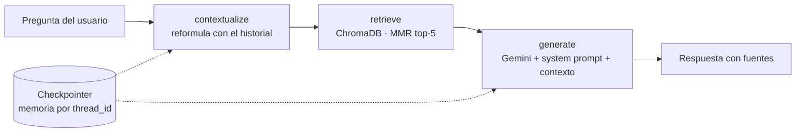

# 📊 Analytica: asistente experto en Google Analytics 4

Proyecto final del módulo de **IA Generativa** del Máster en Data Science (Evolve).

Agente conversacional que responde preguntas sobre **Google Analytics 4** con **RAG** (Retrieval-Augmented Generation). Usa la documentación oficial de Google como base de conocimiento, **Gemini** como LLM y para los embeddings, **ChromaDB** como base vectorial y **LangGraph** para orquestar el agente con **memoria de conversación**.

| Componente | Tecnología |
|---|---|
| LLM | Google Gemini Flash (se elige automáticamente el más reciente disponible) |
| Embeddings | Gemini Embeddings (`gemini-embedding-001`) |
| Base vectorial | ChromaDB (persistente, distancia coseno) |
| Agente | LangGraph + LangChain |
| Memoria | Checkpointer de LangGraph (`InMemorySaver`) por `thread_id` |
| Entorno | Jupyter Notebook / Google Colab |
| Interfaz (bonus) | Streamlit |

---

## 1. Dominio elegido

**Analítica web con Google Analytics 4.** GA4 es la herramienta de medición más usada en marketing digital, pero su documentación está repartida en decenas de artículos y cambia con frecuencia (por ejemplo, las «conversiones» pasaron a llamarse «eventos clave»). Analytica responde dudas de configuración, eventos, informes y atribución con la documentación oficial y cita de dónde sale cada respuesta.

**Base de conocimiento:** 16 artículos oficiales en español, por encima del mínimo de 3 documentos / ~20 páginas. El notebook muestra el recuento exacto de caracteres y páginas.

| Bloque | Documentos |
|---|---|
| Fundamentos | Introducción a GA4, ID de medición |
| Eventos | Acerca de los eventos, eventos automáticos, medición mejorada, eventos recomendados, parámetros, dimensiones y métricas personalizadas |
| Depuración | Informe en tiempo real, DebugView |
| Adquisición y atribución | Grupo de canales predeterminado, rutas de atribución, rendimiento de todos los canales |
| Implementación (developers) | Enviar eventos, comercio electrónico, referencia de eventos recomendados |

La lista completa con sus URLs está en [`src/config.py`](src/config.py). Las páginas se descargan al construir el índice, así que el repositorio no redistribuye su contenido. También se pueden añadir PDFs, `.md` o `.txt` propios en [`data/`](data/).

## 2. Arquitectura



**Pipeline de indexación:** descarga → limpieza HTML (BeautifulSoup, sin menús ni scripts) → chunking (`RecursiveCharacterTextSplitter`, 1.000 caracteres con 150 de solapamiento) → Gemini Embeddings → ChromaDB.

**Por qué tres nodos:**
- **`contextualize`**: una pregunta de seguimiento como *«¿y cómo se desactiva?»* no sirve para buscar en una base vectorial. Este nodo la reescribe con el historial (*«¿cómo se desactivan los eventos de medición mejorada?»*) para que la memoria también mejore la recuperación, no solo la redacción.
- **`retrieve`**: se ejecuta en **cada** turno, así que las respuestas siempre se apoyan en la documentación. Usa **MMR** para traer fragmentos relevantes y no repetidos.
- **`generate`**: combina el system prompt, el contexto recuperado y los últimos 10 mensajes.

## 3. System prompt y justificación

```text
Eres «Analytica», un consultor experto en Google Analytics 4 (GA4) que ayuda a profesionales de
marketing digital a configurar, medir e interpretar sus datos.

## Cómo respondes
- Te basas ÚNICAMENTE en el CONTEXTO recuperado de la documentación oficial de GA4 que aparece abajo.
- Si el contexto no contiene la respuesta, lo dices con claridad («No encuentro esa información en la
  documentación que tengo») y sugieres qué buscar o reformular. Nunca inventas nombres de eventos,
  parámetros, menús ni límites.
- Cuando el usuario se refiera a algo dicho antes («eso», «el segundo», «¿y cómo se activa?»), usa el
  historial de la conversación para entender a qué se refiere.
- Citas las fuentes al final con el formato: «Fuentes: [título 1], [título 2]».

## Estilo
- Español neutro, tono profesional y cercano, como un analista senior explicando a un compañero.
- Empiezas con la respuesta directa en 1-2 frases y luego das el detalle.
- Usas listas o pasos numerados para procedimientos (rutas del menú de Administración, configuraciones).
- Nombres técnicos tal cual aparecen en GA4 (`page_view`, `purchase`, «Eventos clave»).
- Respuestas concisas: máximo ~250 palabras salvo que pidan más detalle.

## Límites
- Si la pregunta no tiene relación con analítica web o GA4, indicas amablemente que solo puedes
  ayudar con Google Analytics 4.
- No das consejos legales sobre privacidad o consentimiento; puedes explicar lo que dice la
  documentación y recomendar consultar a un especialista.

## CONTEXTO
{context}
```

| Decisión de diseño | Justificación |
|---|---|
| **Rol con nombre y público definido** | Fija el dominio y mantiene un tono coherente entre turnos. Saber que habla con profesionales de marketing ajusta el nivel técnico. |
| **Responder solo con el contexto** | En GA4 es muy fácil inventar un nombre de evento o una ruta de menú plausible pero falsa. Anclar la respuesta al contexto recuperado es la principal defensa contra alucinaciones. |
| **Frase explícita cuando no hay información** | Admitir el límite y sugerir otra búsqueda es más útil que una respuesta inventada, y hace evaluable el comportamiento ante preguntas sin respuesta. |
| **Resolver referencias con el historial** | Complementa la memoria del grafo para que «eso» o «el anterior» se interpreten bien. |
| **Citar fuentes** | Da trazabilidad: el usuario puede verificar en la documentación oficial. |
| **Respuesta directa primero, pasos numerados, ~250 palabras** | Quien configura GA4 necesita la respuesta y el procedimiento, no un ensayo. Los pasos numerados encajan con las rutas de Administración. |
| **Nombres técnicos literales** | Los eventos (`page_view`) y las secciones de la interfaz deben coincidir con lo que el usuario ve en GA4. |
| **Fuera de dominio y sin asesoría legal** | Delimita el alcance. Privacidad y consentimiento requieren un especialista. |

**Prompt de reformulación** (nodo `contextualize`): pide reescribir la pregunta para que se entienda sin historial y **no** responderla, porque su salida se usa solo como consulta de búsqueda.

## 4. Instalación y ejecución

### Requisitos
- Python 3.10 o superior
- Una **API key de Gemini** gratuita, que se crea en [Google AI Studio](https://aistudio.google.com/apikey)
- Dependencias: [`requirements.txt`](requirements.txt) (`langchain-google-genai`, `langchain-chroma`, `langgraph`, `chromadb`, `beautifulsoup4`, `streamlit`…)

### Opción A: Google Colab (la más rápida)
1. Abre `notebooks/asistente_ga4_rag.ipynb` en Colab (*Archivo → Abrir cuaderno → GitHub* y pega la URL del repo).
2. En la barra lateral, abre 🔑 **Secrets**, crea `GOOGLE_API_KEY` con tu clave y activa el acceso del notebook.
3. *Entorno de ejecución → Ejecutar todo*. La primera celda clona el repo e instala las dependencias.

### Opción B: Jupyter local
```bash
git clone https://github.com/joseaespinosa02/asistente-ga4-rag.git
cd asistente-ga4-rag
python -m venv .venv && source .venv/bin/activate   # Windows: .venv\Scripts\activate
pip install -r requirements.txt
cp .env.example .env        # y pega tu GOOGLE_API_KEY dentro
jupyter notebook notebooks/asistente_ga4_rag.ipynb
```

### Interfaz web con Streamlit (bonus)
```bash
streamlit run app/streamlit_app.py
```
La primera ejecución construye el índice (1-2 minutos) y las siguientes lo reutilizan desde `chroma_db/`.

**Despliegue en Streamlit Cloud:** en [share.streamlit.io](https://share.streamlit.io) crea una app desde este repo con el archivo principal `app/streamlit_app.py` y, en *Settings → Secrets*, añade `GOOGLE_API_KEY = "tu_clave"`.

### Cambiar de modelo
Sin tocar el código, con variables de entorno (en `.env` o en los secrets):
```
GEMINI_MODEL=gemini-3.8-flash
GEMINI_EMBEDDING_MODEL=gemini-embedding-001
```
> Si cambias el modelo de embeddings, vuelve a ejecutar la indexación, porque los vectores de modelos distintos no son compatibles.

## 5. Estructura del proyecto

```
asistente-ga4-rag/
├── notebooks/
│   └── asistente_ga4_rag.ipynb   # entregable principal: pipeline completo + demo
├── src/
│   ├── config.py                 # modelos, parámetros RAG, fuentes y carga de la API key
│   ├── ingest.py                 # descarga, limpieza, chunking e indexación en ChromaDB
│   └── agent.py                  # system prompt + grafo LangGraph con memoria
├── app/
│   └── streamlit_app.py          # interfaz web (bonus)
├── data/                         # PDFs/MD propios opcionales (+ caché local, ignorada por git)
├── requirements.txt
├── .env.example                  # plantilla de la API key
└── .gitignore                    # excluye .env, chroma_db/ y la caché
```

## 6. Ejemplos de uso

El notebook documenta 7 preguntas en un mismo hilo de conversación, entre ellas dos que demuestran la memoria:

1. ¿Qué tipos de eventos existen en GA4 y en qué se diferencian?
2. ¿Qué eventos recoge la medición mejorada?
3. **¿Y cómo la activo o desactivo?** → 🧠 se apoya en la respuesta anterior
4. ¿Qué parámetros necesita el evento `purchase` para medir ventas?
5. ¿Puedo editar el grupo de canales predeterminado? Si no, ¿qué alternativa tengo?
6. **Resúmeme en 3 puntos lo que hemos visto sobre eventos al principio.** → 🧠 memoria de varios turnos
7. ¿Me recomiendas una receta de paella? → rechazo fuera de dominio

## 7. Seguridad
- La API key **nunca** está en el código: se lee de Colab Secrets, `.env` o los secrets de Streamlit.
- `.env`, `chroma_db/` y la caché de descargas están en `.gitignore`.

## Autor
**José Alejandro Espinosa**, Máster en Data Science, Evolve España.
